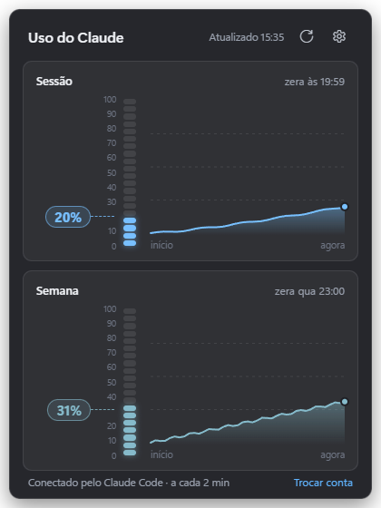
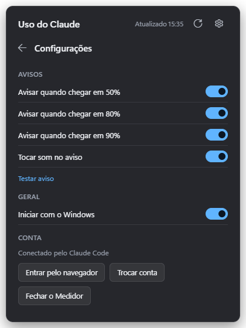

# Medidor Claude

Mostra o seu uso do Claude na bandeja do Windows, ao lado do relógio. Sem precisar abrir o site.

  
  

- Ícone com a porcentagem da sessão de 5 horas e uma barrinha que muda de cor: azul-claro, amarelo, vermelho.
- Passe o mouse para ver sessão, semana e quando cada uma zera.
- Clique para abrir o painel com medidores e gráfico.
- Avisos com som em 50%, 80% e 90%.
- Abre junto com o Windows.

> Projeto não oficial, sem vínculo com a Anthropic.

## Baixar e instalar

1. Baixe o `MedidorClaude-Setup-<versão>.exe` na página de [Releases](../../releases/latest).
2. Abra o arquivo. Ele instala só para o seu usuário, sem pedir administrador.
3. O Windows pode mostrar **"O Windows protegeu o computador"**, porque o app não tem assinatura digital. Clique em **Mais informações** e depois em **Executar assim mesmo**.

## Login

- **Já usa o Claude Code logado?** Funciona sozinho. O medidor lê o login do Claude Code no seu PC, só para leitura.
- **Tem o Claude Code, mas sem login?** Use **Entrar pelo navegador principal**. Abre o login no seu navegador e mostra o link para copiar e colar.
- **Não tem o Claude Code?** Use **Entrar nesta janela** com "Continuar com e-mail". O código chega no seu e-mail.

Se o login do Claude Code expirar, abra o Claude Code uma vez e o medidor volta sozinho.

## Como funciona

A cada 2 minutos o app lê o mesmo dado da tela Configurações > Uso do Claude. Com o login do Claude Code ele usa `api.anthropic.com/api/oauth/usage`. Com o login pelo site ele usa `claude.ai/api/organizations/<org>/usage`. Esses endereços não são documentados e podem mudar.

Nada é enviado para outro lugar. Os dados ficam no seu PC.

## Desenvolver

- `scripts/install.ps1` e `scripts/install-electron.ps1`: instalam as dependências. O npm 11 não roda o download do Electron sozinho.
- `npm start`: roda o app. `npm run mock`: roda com dados de exemplo.
- `npx electron . --mock --screenshot`: salva prints do painel e dos ícones em `shots/`.
- `scripts/build.ps1`: gera o instalador em `dist/`.
- No terminal do VS Code, desative `ELECTRON_RUN_AS_NODE` antes de rodar o Electron.

## Licença

MIT
